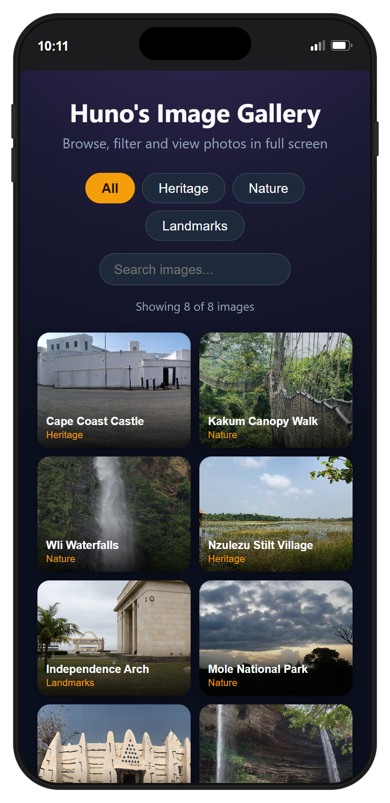
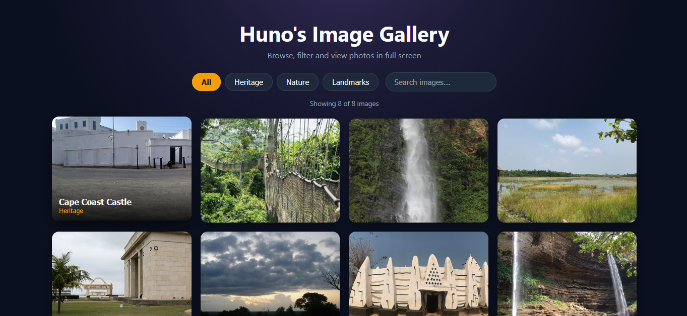

# CodeAlpha_ImageGallery

A responsive image gallery built with plain HTML, CSS and JavaScript as part of the CodeAlpha Frontend Development internship (Task 1).

## Features

- Responsive CSS Grid layout (`auto-fill` + `minmax`) that adapts from phones to desktops
- Lightbox viewer with next/previous buttons, image counter and captions
- Keyboard navigation: `←` `→` to browse, `Esc` to close
- Click outside the image to close, swipe left/right on touch devices
- Hover zoom, caption slide-up and fade-in transitions
- **Bonus:** category filters and live search
- Lazy loading, preloading of neighbouring images, and graceful handling of broken images
- Accessibility: alt text, ARIA labels, focus states, focus trap inside the lightbox
- Respects `prefers-reduced-motion`

## Tech Stack

HTML5, CSS3 (Grid, custom properties, transitions), vanilla JavaScript. No frameworks or libraries.

## Run Locally

Open `index.html` in your browser. No build step needed.

## Gallery Images

The gallery includes locally stored photographs of Ghanaian tourist sites in [`images/`](images/). The photos were downloaded from Wikimedia Commons; their original file pages and licences are listed below.

- `cape-coast-castle.jpg` — [Cape Coast castle](https://commons.wikimedia.org/wiki/File:Cape_Coast_castle.jpg)
- `kakum-canopy-walk.jpg` — [Canopy walk of Kakum National Park](https://commons.wikimedia.org/wiki/File:Canopy_walk_of_kakum_national_park_(1).jpg)
- `wli-waterfalls.jpg` — [Wli WaterFalls](https://commons.wikimedia.org/wiki/File:Wli_WaterFalls.jpg) (CC BY-SA 4.0)
- `nzulezu.jpg` — [Nzulezu, Ghana](https://commons.wikimedia.org/wiki/File:Nzulezu,_Ghana.jpg) (CC BY-SA 4.0)
- `independence-arch.jpg` — [Black Star Square and Independence Arch](https://commons.wikimedia.org/wiki/File:Black_Star_Square_and_Independence_Arch,_Accra,_Ghana.jpg)
- `mole-national-park.jpg` — [Mole Horizon after sunset](https://commons.wikimedia.org/wiki/File:Mole_Horizon_after_sunset.jpg)
- `larabanga-mosque.jpg` — [Larabanga Mosque, Ghana](https://commons.wikimedia.org/wiki/File:Larabanga_Mosque,_Ghana.jpg) (CC BY-SA 4.0)
- `boti-falls.jpg` — [Boti Falls Ghana](https://commons.wikimedia.org/wiki/File:Boti_Falls_Ghana.jpg) (CC BY-SA 4.0)

Categories and filter buttons are generated automatically from the data.

## Live Demo

https://codealphaimagegallery-three.vercel.app
GitHub: https://github.com/brah14/CodeAlpha_ImageGallery.git

## Screenshots

### Mobile view

### Desktop view

## Author

Wisdom Huno Tetteh — [GitHub](https://github.com/brah14)
